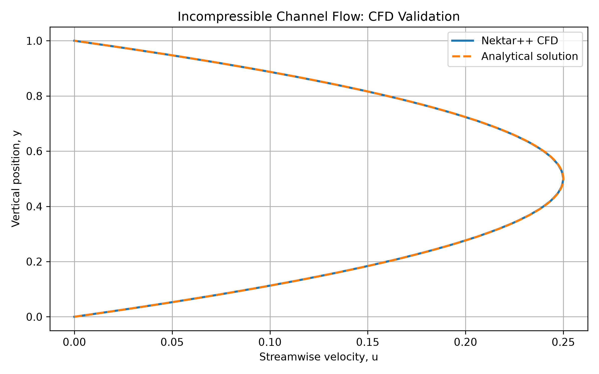
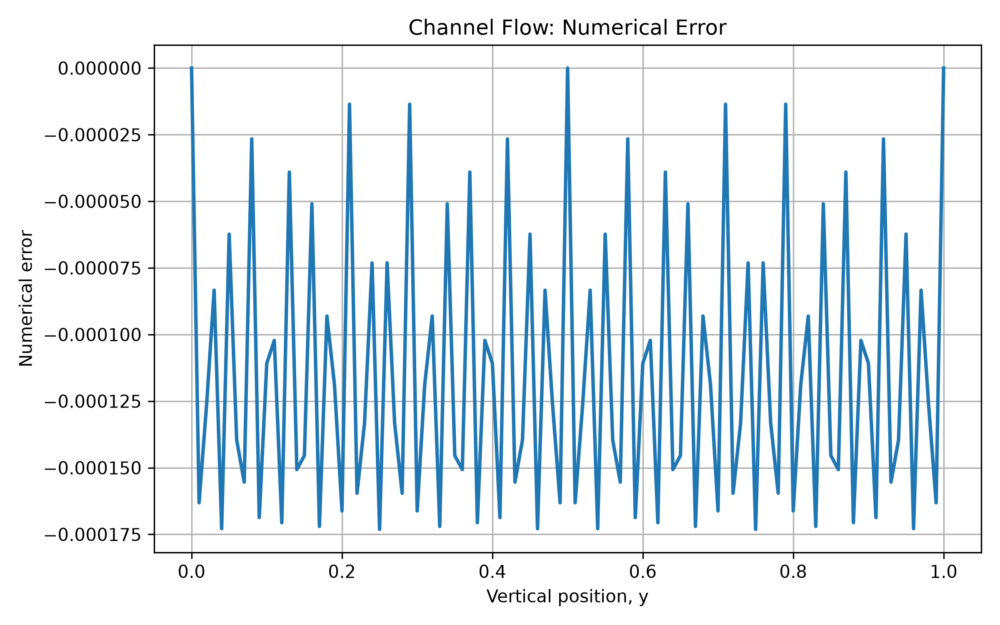

# Case 01: Two-Dimensional Incompressible Channel Flow

## 1. Objective

This was an introductory study that reproduces an existing Nektar++ incompressible channel-flow test case to develop an understanding of the spectral/hp-element framework, numerical simulation workflow, and post-processing tools. 

The numerical velocity profile is compared to the analytical solution to determine agreement and study the effects of visualization resolution. 

## 2. Numerical Method

The 2D incompressible Navier-Stokes equations are solved in the simulation:

∇ · u = 0
∂u/∂t + (u · ∇)u = -∇p + ν∇²u

The simulation makes use of:

- Solver: Nektar++ IncNavierStokesSolver
- Numerical formulation: Continuous Galerkin spectral/hp elements
- Time integration: IMEX velocity-correction scheme
- Polynomial expansion: 3 modes
- Time step: 0.001
- Number of time steps: 1000
- Kinematic viscosity: 1

The configuration is adopted from the Nektar++ 'ChannelFlow2D.xml' test case. 

## 3. Analytical Solution

The stream-wise velocity profile is:

u(y) = y(1-y)

where y is the vertical position across the channel.

The maximum velocity occurs at the channel centerline:

u_max = 0.25 at y = 0.5

The profile satisfies the no-slip conditions at y = 0 and y = 1.

## 4. Results

The simulation ran successfully using Nektar++ compiled inside an Ubuntu 24.04 Docker container on Apple Silicon. 

The numerical solution was exported using FieldConvert and visualized with ParaView 6.2. 

### Velocity Profile Validation

The numerical and analytical velocity profiles show close agreement.

### Numerical Error

The error is defined as:

e(y) = u_CFD(y) - u_analytical(y)

The calculated errors for the exported and sampled velocity profile are:

| Metric | Value |

|---|---|

| Sampling points | 101 |

| RMSE | 1.258089e-4 |

| Maximum absolute error | 1.731343e-4 |

| RMSE relative to maximum velocity | 0.0503% |

## 5. Discussion

The numerical velocity profile agrees closely with the analytical solution. 

The oscillatory error pattern is consistent with interpolation effects introduced during conversion of the high-order numerical solution to VTU format and subsequent sampling in ParaView.

Increasing the VTU output resolution from 36 to 1600 points produced a smoother representation of the velocity profile.

The reported RMSE therefore describes the exported and sampled solution, rather than the intrinsic discretization error of the Nektar++ solver.

## 6. Software

- Nektar++: Incompressible Navier–Stokes solver
- Docker: Ubuntu 24.04 development environment
- ParaView 6.2: Flow visualization and data extraction
- Python: NumPy, Pandas and Matplotlib

## 7. Future Work

The next stage will investigate the influence of polynomial resolution and progress to more complex incompressible flow simulations, including flow around a circular cylinder. I am excited to continue expanding my knowledge and skills in CFD using Nektar++